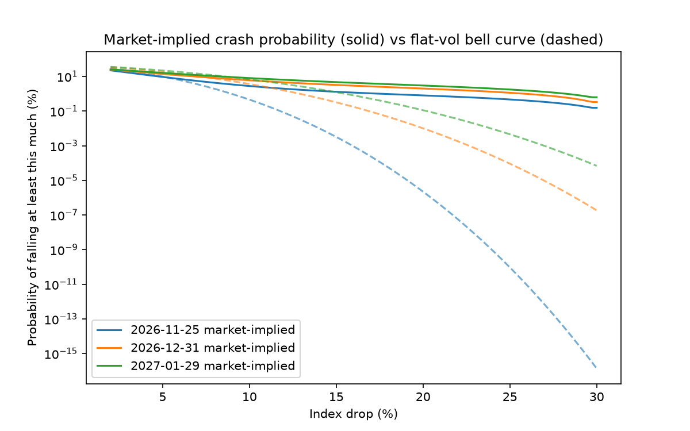

# Option-Implied Tail Risk: Risk-Neutral vs. Historical Crash Probabilities

How likely does the options market think a large S&P 500 drop is, and how does that compare with how often such drops actually happened?

This project reconstructs the market's risk-neutral distribution of S&P 500 returns from SPX option prices and compares its left tail with historical frequencies.



*Solid lines: probability of falling at least this much, implied by SPX options. Dashed lines: what a bell-curve (flat volatility) world with the same at-the-money volatility would imply.*

## Results

Snapshot: SPX option chain pulled on 2026-10-26 (spot 7,683.28). Historical frequencies use S&P 500 daily closes since 1993 over the same horizon as each expiry.

| Horizon | Drop | Market-implied | Flat-vol bell curve | Historical |
|---|---|---|---|---|
| 1 month (21 trading days) | 5%+ | 9.33% | 9.81% | 8.76% |
| | 10%+ | 2.79% | 0.46% | 1.91% |
| | 20%+ | 0.80% | 0.00% | 0.26% |
| 2 months (46 days) | 5%+ | 13.85% | 18.09% | 12.46% |
| | 10%+ | 5.96% | 3.63% | 4.37% |
| | 20%+ | 1.99% | 0.01% | 0.85% |
| 3 months (66 days) | 5%+ | 15.99% | 21.89% | 13.45% |
| | 10%+ | 8.03% | 6.77% | 6.09% |
| | 20%+ | 2.98% | 0.11% | 1.01% |

- For 10% and 20% drops, the market-implied probability is above the historical frequency at all three horizons (about 1.3x to 1.5x at 10%, 2x to 3x at 20%).
- A flat-volatility bell curve badly underestimates large drops: the volatility smile is the market pricing in fat left tails.
- Option prices are risk-neutral, so the gap above history is not a forecast error. It mostly reflects the premium investors pay for crash protection.

## Method

1. **Data.** SPX option chains via `yfinance` for three expiries. Zero-bid and crossed quotes are dropped and mid prices are used (`pull_chain.py`).
2. **Forward and discount factor.** Put-call parity gives `C - P = df * (F - K)`, so a regression of call minus put on strike returns both `df` (slope = -df) and `F` (intercept = df * F).
3. **Implied volatility.** Out-of-the-money options only (puts below the forward, calls above), inverted with a Black-Scholes root-finder (`bs.py`, `smile.py`).
4. **Smoothing.** A quartic polynomial in log-moneyness fitted to the smile, with outlier quotes removed iteratively.
5. **Crash probabilities.** Puts are repriced on a fine strike grid from the smooth smile. Since a put spread pays off when the index finishes below a strike, `P(S_T < K) = (1/df) * dP/dK`, and the derivative is taken numerically (`crash_prob.py`).
6. **Comparison.** Against a flat-volatility Black-Scholes world and against historical frequencies of point-to-point drops over the same horizon (`historical.py`).

## Validation

`test_bs.py` runs on synthetic Black-Scholes prices where the answer is known:
- implied volatility is recovered to within 1e-6;
- the put-spread probability matches the exact Black-Scholes probability to within 0.01 percentage points.

Run with `python3 -m pytest`.

## Limitations

- **Single snapshot.** One day of option data, so results describe that day's market, not a general rule.
- **Not conditioned on volatility.** Historical frequencies average calm and turbulent periods since 1993, while the options reflect today's volatility level.
- **Overlapping windows.** Each trading day starts a new historical window, so the effective sample is smaller than the window count suggests.
- **Deep out-of-the-money quotes are sparse and noisy.** The 20% figures rely on thin quotes and polynomial smoothing and are less reliable than the 5% and 10% figures. Results beyond about a 25% drop are extrapolation.
- **Smoothing choice.** A quartic polynomial is a simple choice; other parametrisations (splines, SVI) could give somewhat different tails.
- **Risk-neutral is not real-world.** The comparison shows how the market prices tail risk, not who is right.

## Reproduce

```
pip install -r requirements.txt
python3 pull_chain.py     # pull a fresh chain (US market hours only)
python3 smile.py          # forward, discount factor, implied vol smile
python3 crash_prob.py     # crash probabilities and comparison
python3 historical.py     # historical frequencies on their own
python3 -m pytest         # validation on synthetic prices
```

The chain used for the results above is saved as `chain_SPX_20261026.csv`, so the analysis can be reproduced without live data. Note that `pull_chain.py` saves a new dated file each run and the later scripts read the latest one.

## Files

| File | Purpose |
|---|---|
| `pull_chain.py` | Download and clean SPX option chains |
| `bs.py` | Black-Scholes price and implied-volatility solver |
| `smile.py` | Parity regression, implied vols, smile plot |
| `crash_prob.py` | Smoothing, risk-neutral CDF, comparison and plot |
| `historical.py` | Historical frequency of large drops |
| `test_bs.py` | Tests on synthetic Black-Scholes prices |
